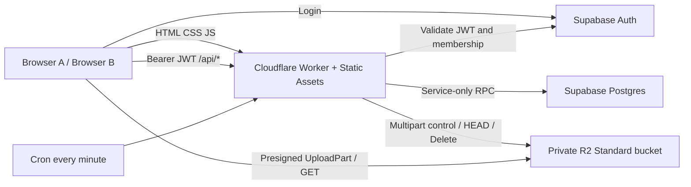

# Terminal Transfer — System Design

> **อัปเดตความต้องการล่าสุด:** การเปลี่ยนเป็นไม่ต้องล็อกอินและเมนูผู้รับเดียว/หลายผู้รับ ให้อ้างอิง [spec v2](2026-11-13-anonymous-sharing-design.md) ซึ่งแทนข้อกำหนด Auth/ownership/sharing ของเอกสารนี้ โค้ด baseline ยังเป็น v1 จนกว่าจะ implement [handoff](../../handoffs/2026-11-13-anonymous-sharing.md)

วันที่: 13 พฤศจิกายน 2026 | สถานะ: ผู้ใช้สั่งเริ่ม implementation แล้ว; รายละเอียดปรับตามผลตรวจอยู่ใน docs/implementation-progress.md

## 1. เป้าหมายและขอบเขต

เว็บส่งไฟล์ข้ามเครื่องสำหรับใช้ส่วนตัวหรือสมาชิกองค์กรเดียวกัน: A ล็อกอิน อัปโหลดไฟล์ รับ ukid ส่งให้ B; B ล็อกอิน กรอกรหัส เห็นข้อมูลไฟล์ และดาวน์โหลดได้ โดย A ปิดเครื่องหลังอัปโหลดเสร็จได้

ข้อกำหนดที่ผู้ใช้ระบุ: Frontend บน Cloudflare, ไฟล์ใหญ่กว่า 50 MB, Storage บน R2, อายุไฟล์เลือกได้รวมถึงไม่หมดอายุ, ค่าเริ่มต้น 24 ชั่วโมง และธีม terminal สลับ dark/light

ข้อเสนอของผู้ออกแบบสำหรับรุ่นแรก: หนึ่งองค์กรต่อ deployment, หนึ่งไฟล์ต่อรายการ, สูงสุด 1 GiB (1,073,741,824 bytes) ต่อไฟล์, พื้นที่รวมแบบนับไฟล์และรายการจองไม่เกิน 8 GiB (8,589,934,592 bytes), ผู้ใช้ที่อยู่ใน allowlist เท่านั้น, บัญชี email/password ที่ผู้ดูแล provision ผ่าน Supabase Dashboard

ไม่รวมรุ่นแรก: สมัครสมาชิกสาธารณะ, multi-tenant SaaS, ส่งตรงแบบ P2P, E2EE, preview เนื้อไฟล์, บีบอัด ZIP บนเซิร์ฟเวอร์, antivirus, native app, ประวัติยืนยันว่าไฟล์ถูกบันทึกลงดิสก์ปลายทางจริง และ WebSocket/Realtime; HTTP เพียงพอสำหรับ flow ที่ตกลงไว้

## 2. ทางเลือกและข้อสรุป

| ทางเลือก | ข้อดี | ข้อแลกเปลี่ยน |
| --- | --- | --- |
| Cloudflare frontend + Supabase Storage Free | บริการรวมน้อย | จำกัด 50 MB จึงไม่ตรงความต้องการล่าสุด |
| Cloudflare frontend + Supabase Storage Pro | ฐานข้อมูล/Auth/Storage อยู่ที่เดียว | มีค่าบริการพื้นฐาน จึงไม่ใช่ตัวเลือกเริ่มฟรีที่คุยกัน |
| Cloudflare frontend/API + R2 + Supabase Auth/Postgres | รองรับไฟล์ใหญ่ มี free usage และใช้ Auth/SQL สำเร็จรูป | ต้องดูแลการเชื่อมสองผู้ให้บริการและงานลบที่ retry ได้ |

เลือกแนวทางที่สามตามบทสนทนา ไม่ใช้ Supabase Storage หรือ Edge Functions เพื่อไม่ซ้ำกับ Worker API ไม่เพิ่ม D1 หรือ KV เพราะมี Postgres แล้ว

## 3. สถาปัตยกรรม

ใช้ React, Vite, TypeScript สำหรับ UI; Hono + TypeScript บน Worker; @supabase/supabase-js สำหรับ Auth/API; AWS SDK S3 client/presigner สำหรับ R2; Zod สำหรับ schema; Vitest และ Playwright สำหรับ verification ที่มีความหมาย

API และ frontend อยู่ origin เดียวกัน; /api/* ต้องเข้าตัว Worker เสมอและห้าม fallback เป็น SPA HTML ส่วน file bytes อัปโหลดตรง R2 ไม่ผ่าน Worker request body ที่มีเพดานต่างจาก R2 ตั้งค่า CORS ของ bucket ให้เฉพาะ origin production/dev และ expose ETag

ทุก API ตรวจ JWT signature, issuer, audience, expiry ผ่าน Supabase asymmetric JWKS และเช็กสมาชิก active ในฐานข้อมูลทุกคำขอ หาก membership หรือ DB ตรวจไม่ได้ให้ปฏิเสธ (503) ไม่เปิดผ่าน JWT อย่างเดียว ใช้โปรเจกต์ที่ตั้ง asymmetric signing key; ไม่รองรับ fallback ข้ามการตรวจ signature

## 4. การใช้งานและ retention

1. Login แล้วเข้าหน้า Send ซึ่งเป็นหน้าหลัก มี drop zone, file picker และ paste ไฟล์จาก clipboard เท่าที่ browser รองรับ ต้องมี picker เสมอ
2. เลือกอายุ 1 ชั่วโมง / 24 ชั่วโมง (default) / 7 วัน / จนกว่าจะลบเอง
3. ส่งไฟล์ทีละส่วน แสดง bytes/progress, ยกเลิกและ retry ส่วนที่ล้มเหลวได้
4. เมื่อ complete และ HEAD ตรวจ size แล้ว จึงเปลี่ยนเป็น ready ออก ukid พร้อม copy code/copy link
5. ผู้รับเข้า Receive วาง ukid หรือเปิด /receive#code=<ukid>; browser อ่าน fragment แล้วล้าง URL ด้วย replaceState; ไม่ใส่ code ใน query, analytics หรือ logs
6. ตรวจบัญชีและ code ก่อนแสดงชื่อ ขนาด วันหมดอายุ; เมื่อกด Download จึงออก signed URL
7. My Files แสดงเฉพาะของผู้ใช้เอง มีเปลี่ยนอายุ ลบ และแสดงสถานะ pending deletion; admin ตรวจยอดพื้นที่รวมได้ แต่ไม่มีหน้า admin จัดการบัญชีในรุ่นแรก

อายุเริ่มนับจาก ready_at หลังอัปโหลดสำเร็จ; retention = 1h | 24h | 7d | forever และ expires_at = null สำหรับ forever การเปลี่ยนอายุคำนวณใหม่จากเวลาที่เปลี่ยน ไม่ใช่เวลาที่เริ่มอัปโหลด แสดงวันเวลาสิ้นสุดให้ตรวจได้ก่อนยืนยัน

การนำ code มากรอกไม่ถือว่าใช้แล้วทิ้ง และไม่เปลี่ยนอายุไฟล์: สมาชิกที่ active และมี code รับได้หลายครั้งจนหมดอายุ/ถูกลบ ไม่มีการผูกไฟล์กับผู้รับคนแรก ใช้เองสองเครื่องผ่านบัญชีเดียวได้

Backend ปิดการออก metadata/download URL ทันทีเมื่อ now >= expires_at แม้ยังไม่ได้ลบ object; signed download URL มีอายุไม่เกิน min(5 นาที, เวลาที่เหลือของไฟล์) เมื่อผู้ส่งลบหรือสมาชิกถูกระงับ ลิงก์ที่ออกไปแล้วอาจใช้ได้จนหมดอายุหรือจน object ถูกลบ และการดาวน์โหลดที่เริ่มแล้วอาจดำเนินต่อไปได้ ไม่รับรอง revoke stream ทันที

สำหรับ forever ยังต้องมีเพดานพื้นที่และลบเองได้ ไม่ตั้ง R2 lifecycle ให้ลบไฟล์ ready ทุกไฟล์ตามอายุ เพราะจะลบไฟล์ forever ด้วย

## 5. ไฟล์ใหญ่และการอัปโหลด

- ใช้ multipart ทุกไฟล์ที่ไม่ว่าง: part size 16 MiB, concurrency 3, retries 3 ครั้งต่อ part (exponential backoff + jitter); ส่วนสุดท้ายเล็กกว่า 5 MiB ได้
- 1..1 GiB เท่านั้น ไม่รับไฟล์ 0 bytes ในรุ่นแรก; ขนาดและชื่อเป็นข้อมูล untrusted ทั้งหมด
- สร้าง UUID object key ภายใน server เท่านั้น ไม่ใช้ชื่อไฟล์เป็น path
- Upload session มี hard deadline 2 ชั่วโมงนับจากสร้าง ออก UploadPart URL ครั้งละไม่เกิน 3 parts, อายุ 10 นาทีและไม่เกิน session deadline
- Browser บอกขนาดแต่ Worker ต้องตรวจ part number/expected size และเซ็น Content-Length ที่กำหนดไว้กับ UploadPart; ทำ integration spike ยืนยัน browser PUT ที่เซ็นขนาดกับ R2 ก่อนยึดวิธีนี้ ถ้าผู้ให้บริการไม่ enforce ห้ามปล่อยอัปโหลดแบบไร้เพดาน ให้เปลี่ยนเป็น bounded part endpoint ที่ stream สูงสุด 16 MiB และหยุดเมื่อเกินจำนวน bytes
- Worker เป็นผู้เรียก CompleteMultipartUpload เท่านั้น ใช้ list parts จาก R2 ตรวจจำนวน/ขนาด/ETag ไม่เชื่อรายการจาก browser; HEAD ต้องตรงขนาดที่จองก่อน ready
- Retry ใน tab เดิมและ network reconnect ได้ ภายใต้ session deadline; reload tab เริ่มใหม่และให้ cancel/cleanup session เก่า ไม่สัญญา resume ข้าม browser reload ในรุ่นแรก
- เก็บ ETag เป็น multipart protocol token ไม่แสดงว่าเป็น SHA checksum ของทั้งไฟล์
- Complete ต้องมี lease ใน DB และ idempotent; ถ้า object complete แล้วแต่ DB update ล้มเหลว ให้ reconciler ตรวจ HEAD แล้ว finish state หรือ delete ตาม intent ล่าสุด ไม่เปิดเผยรหัสก่อน ready

## 6. Data model และธุรกรรม

ตารางใน schema ที่ client ไม่มีสิทธิ์อ่านโดยตรง; เปิดเฉพาะ RPC ที่ service_role เรียกได้ SECURITY DEFINER ระบุ search_path ตายตัว และ revoke EXECUTE จาก public/anon/authenticated

- members: user_id PK -> auth.users, role (admin/member), active, created_at
- storage_budget: singleton id, limit_bytes = 8589934592, reserved_bytes, stored_bytes; lock แถวนี้ก่อน reserve/release ทุกครั้ง
- transfers: id UUID, owner_id, original_name (1..255 chars, strip controls), size_bytes, object_key UNIQUE, state, retention, ready_at, expires_at, code_hash UNIQUE nullable, code_ciphertext nullable, created_at, delete_requested_at, deleted_at
- uploads: transfer_id UNIQUE, upload_id nullable, hard_deadline, latest_url_expires_at, expected_parts, completed_parts metadata, lease_until, lease_generation bigint, external_operation_started_at, attempt_count
- idempotency_requests: owner_id + key UUID เป็น UNIQUE, normalized_request_sha256, transfer_id, created_at; เก็บ 7 วัน นับจากสร้าง request และต้องไม่ลบก่อน upload/job เสร็จ; key เดิม payload เดิมคืน id/session เดิมโดยไม่สร้าง multipart เพิ่ม ถ้ารายการถูกลบแล้วคืน 410; key เดิม payload ต่างคืน 409
- cleanup_jobs: transfer_id UNIQUE, not_before, lease_until, attempts, next_attempt_at, last_error_class; เก็บไว้จนยืนยันลบ object และ abort upload สำเร็จ
- access_events: UUID, transfer_id, actor_id, kind (uploaded/code_resolved/download_url_issued/delete_requested/deleted/retention_changed), created_at; เก็บ 30 วัน ไม่มี raw code/URL/JWT
- rate_windows: actor_id + action + minute เป็น PK, count; ล้างย้อนหลังเกิน 1 วัน

สร้าง ukid ด้วย random 128 bits เข้ารหัส Crockford Base32 26 ตัว จัดกลุ่มด้วยขีดใน UI; normalize ตัวพิมพ์และขีดด้วย parser เดียวกัน ไม่ใช่รหัสตัวเลขสั้น เก็บ SHA-256 hash สำหรับค้นหา; เก็บ ciphertext AES-GCM สำหรับ owner กด copy ซ้ำใน My Files โดย encryption key อยู่ Worker secret มี version key สำหรับหมุน key ไม่ log plaintext

State machine: allocating -> uploading -> finalizing -> ready -> deleting -> deleted; allocating/uploading/finalizing -> deleting ได้จาก cancel, deadline, error หรือ owner delete; ready ที่หมดอายุให้ guarded transition เป็น deleting ไม่เพิ่ม expired state แยก ระบบแสดง label expired จาก expires_at + delete reason

การ reserve ทำ transaction: active member + rate limit + ตรวจยอด stored+reserved+size <= limit แล้วเพิ่ม reserved พร้อมสร้าง allocating; create multipart นอก transaction แล้ว update uploading ถ้าขั้นตอนใดล้มเหลวให้เก็บ intent และชดเชย ไม่อ้างว่าธุรกรรม DB ครอบคลุม R2

การ ready ย้าย reserved -> stored เพียงครั้งเดียวใน transaction พร้อม timestamp และ encrypted code การลบ/abort ต้องยืนยันกับ R2 ก่อน release budget; ห้ามลบแถว DB ก่อน object เพื่อไม่เสียตำแหน่งไฟล์ค้าง ขนาดที่ pending deletion ยังนับพื้นที่อยู่

## 7. API contract

ทุก endpoint ยกเว้น static ใช้ Bearer JWT; response error เป็น {error:{code,message},requestId}; ไม่มี raw provider errors; JSON no-store

| Method / Path | Request | Result |
| --- | --- | --- |
| GET /api/me | - | user, role, budget usage |
| POST /api/transfers | {name,sizeBytes,retention}; Idempotency-Key UUID | {id,state,partSizeBytes,partCount,uploadDeadline} |
| POST /api/transfers/:id/parts | {partNumbers:number[]} | {parts:[{partNumber,url,expiresAt}]} เฉพาะ owner |
| POST /api/transfers/:id/complete | {} | {id,code,readyAt,expiresAt} เฉพาะ owner |
| POST /api/transfers/resolve | {code} | {id,name,sizeBytes,expiresAt} สำหรับ active member |
| POST /api/transfers/:id/download | {code} สำหรับผู้รับ; {} สำหรับ owner | {url,expiresAt} |
| GET /api/transfers?cursor=... | - | รายการ owner, nextCursor, สูงสุด 25 แถว |
| GET /api/transfers/:id | - | metadata/status owner เท่านั้น |
| POST /api/transfers/:id/code | {} | {code} owner ของ ready ที่ยังไม่หมดอายุ |
| PATCH /api/transfers/:id | {retention} | metadata ใหม่ owner เท่านั้น และห้าม revive expired |
| DELETE /api/transfers/:id | - | 202 {state:'deleting'}; ซ้ำแล้วผลเดิม |

resolve/download ต้องตรวจ code ใหม่ ไม่ถือว่า UUID transfer id เป็นสิทธิ์เข้าถึงไฟล์; unknown/not allowed/expired code ตอบข้อความเดียวกัน 404 เพื่อไม่ยืนยันว่ามีไฟล์อยู่; JWT invalid 401, inactive 403, quota 409, rate 429, file too large 413, unavailable 503

Rate policy: create 10/min/user, resolve+receiver download รวม 30/min/user, API อื่นรวม 120/min/user ใช้ atomic DB counter (ไม่ใช้ in-memory isolate); login ใช้ Supabase Auth rate limits ไม่สร้าง proxy login ใหม่

## 8. Cleanup, safety และการ deploy

Cron ทุกนาที claim งานเป็น batch 3 ด้วย lease, guarded transition สถานะ, abort multipart เมื่อไม่ควรรับเพิ่ม แล้ว delete object และ release budget งาน retry ใช้ backoff สูงสุด 1 ชั่วโมง มี alert เมื่อค้างเกิน 10 นาที ห้ามอ้างว่าลบตรงวินาที ปรับจาก 25 หลัง implementation review เพื่อไม่เกิน Workers Free subrequest limit; ทุก invocation มี shared budget 40 และ reconciliation page ละ 3 รายการ

ทุก lease มี generation token เพิ่มขึ้นต่อการ claim; CAS update ต้องตรวจ token + state ทั้งก่อนและหลัง external operation ตั้ง timeout คำขอ R2 30 วินาที แต่ไม่ถือว่า timeout ยกเลิกงานที่ R2 แล้ว หาก stale worker ได้ create/complete success ห้าม activate/ready และต้อง enqueue abort/delete พร้อม key/uploadId ที่ได้คืน การ complete เกิดที่ Worker เท่านั้น ห้ามคืนสิทธิ์ complete ให้ browser

หาก CreateMultipartUpload สำเร็จแต่บันทึก upload_id ไม่ได้ ให้สถานะ allocating/deleting คง reservation ไว้และ cleanup ทำ ListMultipartUploads แบบ paginated โดย prefix object key ที่ไม่ซ้ำ เพื่อ abort ทุก upload ที่พบ ทำซ้ำเมื่อผลลัพธ์กำกวม; daily scan ต้องตรวจทั้ง completed objects และ incomplete uploads ใช้ lifecycle abort incomplete หลัง 1 วันเป็น safety net และเก็บ tombstone 7 วันพร้อมกวาดซ้ำ ห้ามสร้าง multipart ใหม่ด้วย key เดิมเมื่อคำขอ create ก่อนหน้ายังไม่ทราบผล

กรณี external operation ไม่ทราบผล ให้คง reservation จนพ้น 24 ชั่วโมงจาก operation ล่าสุด และผ่าน reconciliation ยืนยันไม่มีทั้ง object/incomplete upload จึง release; กรณีปกติที่ไม่มี operation กำกวมลบและคืนพื้นที่ในรอบถัดไปได้ การลบในระบบที่ใช้ storage แยกไม่ใช่ distributed transaction จึงต้องแจ้ง pending deletion ตามจริง ไม่รับรองว่าพื้นที่คืนทันทีทุก failure mode

ห้าม complete ที่กำลัง deleting แม้ยังมี upload URL; งานลบติดตาม lease และรอ latest_url_expires_at + 2 นาที ก่อน final reconciliation เพื่อกัน late operation ทุกครั้งตรวจ object key เดิมอีกครั้งและ delete ซ้ำได้ งาน allocating/finalizing เกิน lease ต้อง reconcile แทนปล่อยทิ้ง

R2 lifecycle ใช้เป็น safety net สำหรับ incomplete multipart เท่านั้น (ไม่ใช่ minute-level expiration); ทำ daily reconciliation แบบ paginated เทียบ bucket prefix กับ DB เพื่อตรวจ orphan โดย grace 24 ชั่วโมงและไม่แตะ active leases

ใช้ R2 Standard ไม่ใช้ Infrequent Access สำหรับไฟล์ชั่วคราว โควตาฟรีเป็น GB-month และจำนวน operations ไม่ใช่ hard spending cap; limit 8 GiB ของแอปเป็น guardrail ไม่รับรองบิลเป็นศูนย์เพราะมีบริการอื่นและส่วนอัปโหลดค้าง ต้องมี billing alerts และ quota monitoring

Secrets ใน Cloudflare: SUPABASE_SERVICE_ROLE_KEY, R2_ACCESS_KEY_ID, R2_SECRET_ACCESS_KEY, SHARE_CODE_KEYS (JSON keyring version -> base64 key); config ที่ไม่ลับ: SHARE_CODE_ACTIVE_KEY, SUPABASE_URL, JWT issuer/audience, R2_ACCOUNT_ID, bucket, allowed origins; browser มีเฉพาะ Supabase URL และ publishable key ไม่ส่ง service keys

Frontend security headers: CSP จำกัด script/connect origins ที่จำเป็น, Referrer-Policy no-referrer, X-Content-Type-Options nosniff; signed GET บังคับ attachment ใช้ safe Content-Disposition รองรับ UTF-8 ไม่ render HTML/SVG จากไฟล์ เปิด R2 public URL/r2.dev ไม่ได้

Production/staging ใช้ bucket และ Supabase project แยกกัน ไม่มี production secrets ใน preview; migration ผ่าน reviewed SQL; ไม่ deploy จริงหรือสร้างบริการก่อนผู้ใช้อนุมัติขั้น implementation

Free tier deploy ได้สำหรับทดลองใช้/งานภายในที่ยอมรับข้อจำกัด แต่ Supabase Free อาจ pause เมื่อ idle และไม่มี uptime guarantee ต้องมีข้อความระบบไม่พร้อมใช้งานและ runbook resume ห้ามทำ keepalive เพื่อหลบเงื่อนไขแพ็กเกจ

## 9. Frontend terminal และ dark/light

ธีมเป็น visual language ของ terminal แต่ใช้ปุ่ม ฟอร์ม และแท็บมาตรฐาน ไม่บังคับพิมพ์คำสั่งจริง ชื่อชั่วคราวของเว็บ: TRANSFER ใช้ UI ภาษาไทยและ label คำสั่งสั้นภาษาอังกฤษ

- Desktop: header `> TRANSFER`, tabs `send / receive / files`, theme selector และ account menu; content กว้างไม่เกิน 1120px
- Send: panel `$ transfer send`, drop zone ขอบเส้นประ, retention selector, queue/progress และผลลัพธ์ code
- Receive: panel `$ transfer receive`, ช่องรหัสพร้อมปุ่มรับไฟล์; แสดง metadata หลัง resolve เท่านั้น
- Files: ตารางชื่อ ขนาด สถานะ วันหมดอายุ และ actions; mobile เปลี่ยนเป็น cards ไม่มี scroll ทั้งหน้าในแนวนอน
- Upload/Download/Copy สำเร็จและ error ใช้ status line ที่ screen reader อ่านได้ ไม่ทำ terminal log ยาวเป็น UI หลัก
- ไม่ใช้ scanline, glitch, auto typing, flicker หรือเสียง; ใช้ reduced-motion; keyboard focus เห็นชัดและไม่มี keyboard shortcut แย่งการพิมพ์
- Theme selector `System / Dark / Light`; ค่าเริ่มต้น System, persist ใน localStorage, ตั้ง theme ก่อน paint ลด flash; การเปลี่ยน OS มีผลเมื่อเลือก System เท่านั้น
- Typography: system monospace สำหรับรหัส/label; Thai ใช้ Noto Sans Thai หรือ system Thai fallback เพื่ออ่านง่าย; self-host font ที่เลือกพร้อม license
- Dark tokens: bg #0B0F14, surface #111923, text #E6EDF3, muted #9AAABD, accent #4ADE80
- Light tokens: bg #F5F7FA, surface #FFFFFF, text #18212F, muted #526174, accent #166534
- Status มีข้อความและ icon เสมอ ไม่สื่อด้วยสีอย่างเดียว; contrast AA, target >= 44px, รับชื่อไฟล์ไทย/ยาวด้วย wrap และ safe text rendering
- No expiry แสดง `จนกว่าจะลบเอง`; ที่เลือกอายุแสดงข้อความเตือนพื้นที่สะสม; วันที่ใน UI Asia/Bangkok แต่ DB timestamps UTC

## 10. เกณฑ์รับงาน

สอง browser บัญชีต่างกันที่อนุญาตส่งและรับไฟล์ 1 GiB ได้ checksum ที่ปลายทางตรงต้นทางในการ staging verification; inactive/anonymous รับไม่ได้; ผู้ใช้เดา UUID ก็โหลดไม่ได้; ไม่มี secrets ใน dist

เลือก retention ทั้งสี่ค่าได้; 24h default; forever ไม่ถูก scheduled expiry ลบ; ลบ/หมดอายุแล้วไม่ออกลิงก์ใหม่; งาน cleanup retry แล้วคืนยอดพื้นที่ครั้งเดียว; cancel, network fail, finalization crash และ pending upload ไม่ทิ้ง object โดยไร้ tracking

Dark/light/system ใช้ได้ทั้ง mobile/desktop, keyboard และ reduced motion; ไม่มีไฟล์ product หรือ provider resources ถูกสร้างในขั้นออกแบบนี้

## 11. เอกสารอ้างอิงที่ตรวจ ณ 2026-11-13

- https://developers.cloudflare.com/workers/static-assets/billing-and-limitations/
- https://developers.cloudflare.com/r2/objects/upload-objects/
- https://developers.cloudflare.com/r2/api/s3/presigned-urls/
- https://developers.cloudflare.com/r2/buckets/object-lifecycles/
- https://developers.cloudflare.com/r2/pricing/
- https://developers.cloudflare.com/workers/configuration/cron-triggers/
- https://supabase.com/pricing
- https://supabase.com/docs/guides/auth/jwts

ตรวจ package versions, CLI และ service limits ใหม่ตอน implementation; ใช้ Cloudflare cf CLI สำหรับโปรเจกต์ใหม่ตาม skill ปัจจุบัน ไม่สร้าง Wrangler config โดยอัตโนมัติ
